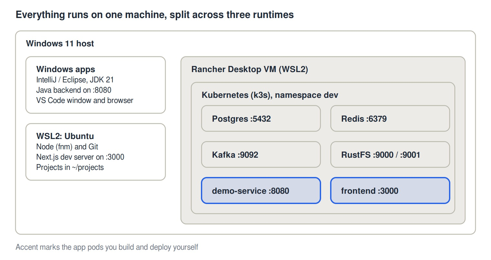
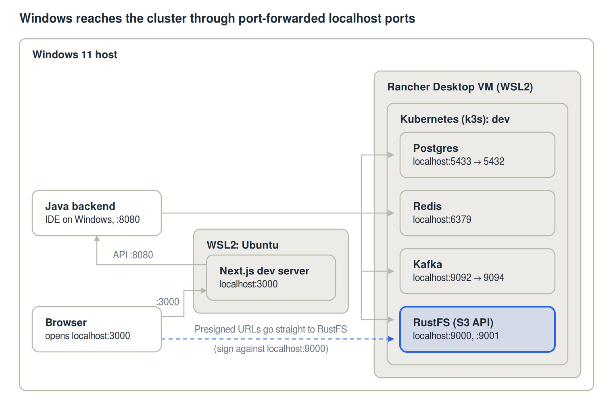
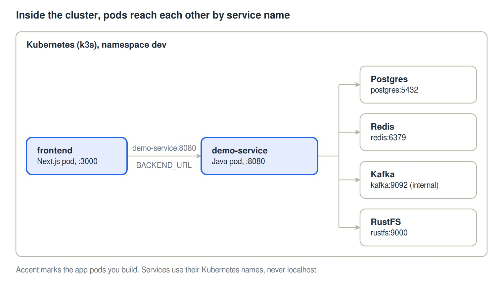

# Local Dev Environment: Architecture and Networking

High-level view of how the Windows development machine is put together: what runs where, which ports are exposed, and how each piece reaches the others.

**Figures**

- Figure 1: Runtimes on one machine
- Figure 2: Connections from Windows into the cluster
- Figure 3: Connections inside the cluster

The diagrams are in the `images` folder next to this file, as JPG (for viewing) and SVG (editable, scales without loss). Keep the folder next to the Markdown file so the images display.

## 1. Scope and goals

A single Windows machine hosts the whole stack for a Next.js frontend and a Java backend. The IDEs and browser run on Windows; the infrastructure runs in a local Kubernetes cluster:

- **Frontend:** Next.js 16, edited in VS Code. Runs as `npm run dev` inside WSL2 (Ubuntu), or as a pod built from its own Dockerfile.
- **Backend:** Java (JDK 21), edited in IntelliJ or Eclipse on Windows. Runs from the IDE or command line, or as a pod. It is not run in Docker Compose.
- **Data and messaging:** Postgres, Redis and Kafka, run as StatefulSets in the `dev` namespace of the local Kubernetes cluster.
- **Object storage:** RustFS (S3-compatible, Apache 2.0) in the same namespace (see section 6).
- **Runtime platform:** Rancher Desktop, which provides the container engine (dockerd) and Kubernetes (k3s) on top of WSL2.
- **Verification:** a Spring Boot `demo-service` and a Next.js `/stack-check` page that exercise all four services end to end.

*Figure 1: Runtimes on one machine. Highlighted boxes are the app pods you build and deploy yourself.*

Windows apps, WSL2 Ubuntu and the Rancher Desktop VM are separate runtimes (Figure 1). All infrastructure, and any app you deploy as a container, runs as pods in the dev namespace of the k3s cluster inside the Rancher VM.

## 2. Layers: what runs where

| Layer | Components | Notes |
|---|---|---|
| Windows host | IntelliJ / Eclipse, VS Code (UI), browser, Java apps launched from the IDE or command line, PowerShell, kubectl | Native Windows processes. |
| WSL2: Ubuntu distro | Node 22 (via fnm), Next.js dev server, Git, VS Code server | Project files live in the Linux filesystem (`~/projects`). |
| WSL2: Rancher Desktop distro | dockerd (moby), k3s Kubernetes | Managed by Rancher Desktop. Images built with `docker build` are visible to the cluster, so no registry is needed. |
| Kubernetes (k3s), namespace `dev` | Postgres, Redis, Kafka, RustFS; optionally `demo-service`, the Java backend and the Next.js frontend as pods | Reached from Windows through `kubectl port-forward` (`port-forward.ps1`). |

## 3. Components and ports

| Component | Where it runs | Port | Reach it from Windows / WSL at |
|---|---|---|---|
| Next.js dev server | WSL2 Ubuntu | 3000 | `http://localhost:3000` |
| Next.js frontend (container) | Pod `frontend` | 3000 | `http://localhost:3000` after `kubectl port-forward svc/frontend 3000:3000` (use this or the dev server, not both) |
| Java backend (IDE) | Windows | 8080 | `http://localhost:8080` |
| demo-service | Pod `demo-service` | 8080 | In the cluster: `http://demo-service:8080`. From Windows: port-forward to a free local port |
| Postgres | Pod `postgres-0` | 5432 | `localhost:5433` (forward 5433 to 5432) |
| Redis | Pod `redis-0` | 6379 | `localhost:6379` |
| Kafka broker | Pod `kafka-0` | 9092 (internal), 9094 (external) | `localhost:9092` (forward 9092 to 9094) |
| RustFS S3 API | Pod `rustfs-0` | 9000 | `http://localhost:9000` |
| RustFS console | Pod `rustfs-0` | 9001 | `http://localhost:9001/rustfs/console/` |

## 4. Connection matrix: who talks to whom

| From | To | Address used | Notes |
|---|---|---|---|
| Browser (Windows) | Next.js | `localhost:3000` | WSL2 forwards localhost to Windows. For the pod, port-forward the frontend service. |
| Next.js server code (pod) | demo-service or backend | `http://demo-service:8080` | Set through `BACKEND_URL`. Server-side only: browsers cannot resolve cluster names. |
| Next.js dev server (WSL) | Java backend (Windows) | `localhost:8080` | WSL may not reach Windows localhost unless mirrored networking is on in `.wslconfig`. |
| Java backend (IDE / CLI) | Postgres | `jdbc:postgresql://localhost:5433/appdb` | Needs the port-forward. User `dev`, password `dev` (dev only). |
| Java backend (IDE / CLI) | Redis | `localhost:6379` | Needs the port-forward. |
| Java backend (IDE / CLI) | Kafka | `localhost:9092` | EXTERNAL listener, advertised as `localhost:9092`. The local forward port must stay 9092. |
| Java backend (IDE / CLI) | RustFS | `http://localhost:9000` | Dev credentials `rustfsadmin` / `rustfsadmin`. |
| Pods in Kubernetes | Postgres | `jdbc:postgresql://postgres:5432/appdb` | Service name in the same namespace. |
| Pods in Kubernetes | Redis | `redis:6379` | |
| Pods in Kubernetes | Kafka | `kafka:9092` | INTERNAL listener. |
| Pods in Kubernetes | RustFS | `http://rustfs:9000` | |
| Browser | RustFS | `localhost:9000` | Presigned URLs must use an address the browser can reach. |

*Figure 2: Connections from Windows into the cluster. Every arrow that enters the Kubernetes boundary is a `kubectl port-forward` on a localhost port. The dashed arrow is the browser fetching RustFS presigned URLs directly.*

Boundaries show where each piece runs: Java and the browser on Windows, the Next.js dev server in WSL2 Ubuntu, and Postgres, Redis, Kafka, RustFS and any app pods inside the Kubernetes cluster in the Rancher Desktop VM (Figure 2). Connections from Windows enter the cluster through kubectl port-forward on localhost ports. Browsers also open RustFS's signed URLs directly, so those must point at localhost:9000.

*Figure 3: Connections inside the cluster. Pods reach services by Kubernetes service name, never localhost. Highlighted boxes are the app pods you build.*

Inside the cluster there is no port-forward and no localhost (Figure 3). The frontend calls `demo-service:8080` through `BACKEND_URL`, and `demo-service` reaches Postgres, Redis, Kafka (internal listener) and RustFS by service name.

## 5. Networking notes

1. **Port-forward is the bridge.** Nothing in the cluster is published to Windows automatically. `port-forward.ps1` starts one `kubectl port-forward` per service (Postgres 5433, Redis 6379, Kafka 9092, RustFS 9000 and 9001). If a pod restarts, its forward ends and the script must be run again.
2. **One cluster network.** Compose is retired, so there is no second container network. Pods in the `dev` namespace reach each other by service name: `postgres`, `redis`, `kafka`, `rustfs`, `demo-service`.
3. **Kafka listeners.** The broker has two listeners. INTERNAL is advertised as `kafka:9092` for pods. EXTERNAL binds to 9094 in the pod but is advertised as `localhost:9092`, so clients on Windows connect through the forward that maps `localhost:9092` to pod port 9094. The advertised port and the local forward port must match.
4. **Server-side versus browser calls.** Next.js server code (server components, route handlers) can call `http://demo-service:8080`. Code running in the browser cannot resolve cluster names, so it needs a URL reachable from Windows or a server-side proxy. `NEXT_PUBLIC_*` variables are fixed at build time.
5. **Presigned URLs.** URLs generated by the backend embed the S3 endpoint (RustFS). If the backend signs against an in-cluster name, the browser cannot open them. Sign against the address the browser uses (`localhost:9000`).
6. **Images without a registry.** The engine is dockerd, so images built locally with `docker build` are visible to k3s. Manifests use explicit tags (not `latest`) with `imagePullPolicy: IfNotPresent`.
7. **Filesystem placement.** Keep Next.js projects inside WSL (`~/projects`), not under `/mnt/c`. Keep Java projects on native Windows for IntelliJ. From WSL, `localhost` may not reach Windows services unless `networkingMode=mirrored` is set in `.wslconfig`.

## 6. RustFS in Kubernetes

- **Where:** the `dev` namespace, as a StatefulSet with a 10 GiB PersistentVolumeClaim on k3s's default local-path storage.
- **Image:** `rustfs/rustfs:1.0.0`, pinned. RustFS is Apache 2.0 licensed and reached 1.0.0 in 2026, so it is a young project: read the release notes before upgrading.
- **Credentials:** Secret `rustfs-credentials` (`rustfsadmin` / `rustfsadmin`, dev only).
- **Settings:** data volume `/data`, S3 API on 9000, console on 9001 (`/rustfs/console/`), health endpoint `/health` on 9000. The pod disables Kubernetes service links so the injected `RUSTFS_*` variables do not clash with RustFS's own settings.
- **Access:** Service `rustfs` on 9000 (API) and 9001 (console), forwarded to Windows by `port-forward.ps1`.
- **Replacement path:** the S3 API is standard, so moving to another S3-compatible server (for example SeaweedFS) means changing the image and settings in `rustfs.yaml`; application code stays the same.

## 7. Setup order

1. Base tools via the winget script (done).
2. Rancher Desktop with dockerd and WSL integration (done).
3. Kubernetes enabled, `kubectl` pointing at the `rancher-desktop` context (done).
4. Postgres in Kubernetes, port-forwarded to `localhost:5433` (done).
5. Redis, Kafka and RustFS manifests (provided; deploy and verify).
6. `demo-service` and the Next.js frontend: images and manifests (provided; deploy and verify).
7. Postponed: VS Code to WSL connection and extensions, IntelliJ to Postgres.

## 8. Open questions

- Which Postgres version does production use? The cluster currently runs 17.
- Keep RustFS for local object storage, or move to another S3-compatible server if it proves unstable?
- Should the stack start automatically at boot, or only when Rancher Desktop is opened? k3s starts with Rancher Desktop; the port-forwards do not.

## 9. Verifying the stack

1. Deploy the infrastructure: run `kubectl apply -k .` in the `k8s-dev` folder, then watch `kubectl -n dev get pods` until every pod is Running.
2. Start the forwards: `.\port-forward.ps1`.
3. Run `demo-service` from the IDE (its defaults point at localhost) and open `http://localhost:8080/check`. Expect `overall: UP` with postgres, redis, kafka and s3 (the RustFS check) all UP.
4. Run the same checks from inside the cluster: build the image (`docker build -t demo-service:0.1.0 .`), apply `k8s\demo-service.yaml`, then do the same for the frontend and open `http://localhost:3000/stack-check` through its forward.
5. If a service shows DOWN, its error text names the failing connection.
